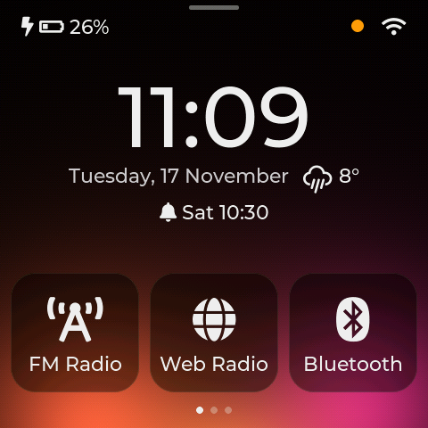
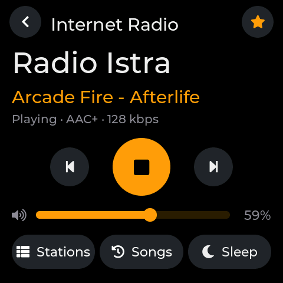
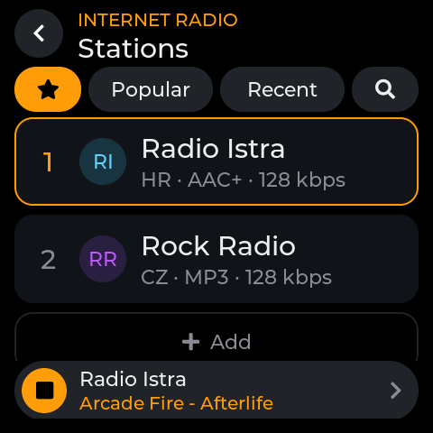
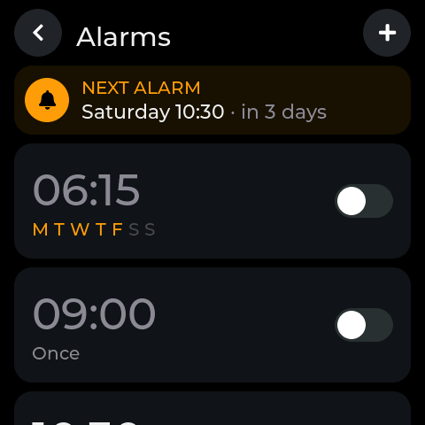
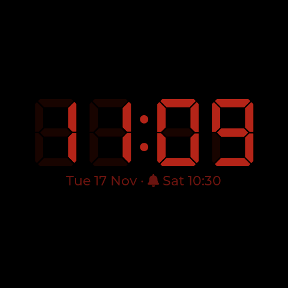
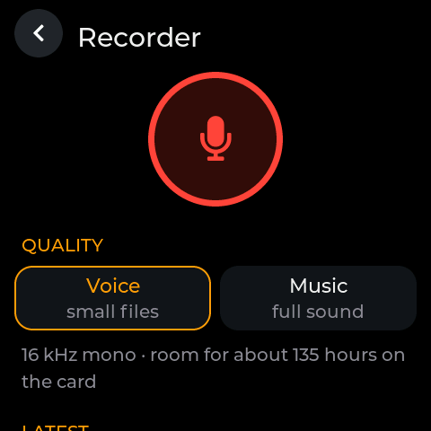

# ESP32 DIY Radio

Firmware that turns a Waveshare ESP32-S3-Touch-AMOLED-2.16 into a small
internet radio and bedside clock: internet radio stations, alarms that wake you
with a tone, a sound from the microSD card or your favourite station, the
weather, a voice and music recorder, a spirit level, and a dimmed clock screen
with several faces, including ones you design yourself in the browser. It is
built with PlatformIO, the Arduino core 3.3 (pioarduino) and LVGL 9.6. It's a
hobby project, so expect some rough edges.

## Screenshots








## Features

### Radio

- Internet radio from the [radio-browser.info](https://www.radio-browser.info)
  directory: the most listened stations in your country, recently played, and
  search by name.
- Favourites (hold a station to add it), shown as numbered presets with the
  stream's codec and bitrate. They can also be edited from the upload page.
- Now Playing: big station name and song title, previous / next favourite,
  volume, and a sleep timer (15, 30, 60 or 90 minutes, then it fades out).
- "Recently heard": the song titles stations sent since the radio was switched on.
- Plays MP3, AAC, FLAC, Opus and Vorbis streams (ESP32-audioI2S).

### Alarms & clock

- Up to 20 alarms, one-off or repeating on chosen days (with Weekdays,
  Weekends and Every day shortcuts), each with its own name, volume, snooze
  length and sound.
- Sounds: three built-in tones (Chime, Beeps, Sunrise), audio files in the
  card's `sounds` folder, or a favourite station. An optional fade-in over a minute.
- Home and the clock screen show the next alarm; the Alarms screen also shows
  a snooze, with Cancel. An alarm nobody answers stops after 15 minutes.
- The clock is set from the internet (NTP) and kept by the board's real-time
  clock (PCF85063); it can also be set by hand in Settings > Date & time.
- The clock screen starts after a chosen time without use (30 s to 10 min, or
  never) and shows the clock, the clock with the weather, or nothing (screen off).
  It has its own brightness and an optional seconds display.
- Built-in faces: Digital, Analog, Split, Night and Segment (7-segment digits).
  Night and Segment come in red or green. Every face moves a few pixels each
  minute to protect the AMOLED from burn-in.

### Weather

- Current conditions, the next 24 hours, the next days and details (feels like,
  humidity, wind, rain, sunrise and sunset), from [Open-Meteo](https://open-meteo.com).
- The location is found automatically from the internet connection, or searched
  by name in Settings > Weather location.

### Recorder

- Records from the board's two microphones to WAV files on the microSD card:
  Voice (16 kHz mono) or Music (48 kHz stereo).
- A list of recordings to play back on the radio; download or delete them from
  the upload page.

### Level

- A spirit level using the motion sensor (QMI8658): left to right with the
  angle, and front to back. "Set as level" calibrates it, and the setting is kept.

### Personalising

- Wallpapers: six built-in designs, or your own pictures sent from the upload page.
- Accent colour: eight to pick from in Settings > Display, applied everywhere.
- Clock faces from the card: design your own on the upload page (background
  picture, time, date, next alarm, weather, an analog clock, text, and your own
  fonts), then pick it in Settings > Clock screen > Face.
- Home tiles: choose their order in Settings > Display > Home tiles. Home shows
  them three at a time; swipe sideways for the rest.
- An on-screen keyboard laid out like a phone's, with accents when you hold a
  letter, and numbers and symbols.

### Control centre & screen lock

- Swipe down from the top edge, on Home or in any app, for the control centre:
  Wi-Fi, Radio, Upload and Lock toggles, plus brightness and volume.
- Auto-rotate (the round button after brightness): stand the radio on its left
  or right side, say to charge it with the cable out of the way, and the screen
  turns to match. Off by default; the motion sensor only runs while it's on.
- Wi-Fi can be switched off completely (remembered across restarts); recordings
  and card files still play.
- Up to five saved Wi-Fi networks; the radio joins the strongest one in range.
- Screen lock (Settings > Clock screen > Lock): a tap on the clock screen only
  shows "slide to unlock". The buttons and a ringing alarm still work.

### Upload page in the browser

While it's switched on, the radio serves a page to any browser on the same
Wi-Fi network, protected by a 4-digit code shown on the radio. From there you can:

- add wallpapers: pick a picture, drag and zoom to frame it, send it (the
  browser converts it to the screen's format);
- make, edit and delete clock faces;
- download and delete recordings;
- add and remove favourite stations.

The page stops by itself after 5 to 60 minutes without activity (you choose),
and switches off after 30 wrong codes.

### Power & battery

- Runs from USB or an optional battery through the board's AXP2101 power chip.
- Charges gently to 4.1 V; the battery level shows on Home.
- On battery: a "Battery low" notice, and when it's nearly empty the radio
  saves its settings and switches itself off cleanly.
- The CPU drops to 80 MHz on the clock screen while nothing plays.
- Settings > About shows the firmware version, memory, battery, USB voltage
  and the power chip's temperature.

### Reliability

- A watchdog restarts the radio if the main task hangs. An alarm that came due
  in the two minutes before a restart still rings, and a ringing or snoozed
  alarm carries on after a restart.
- An alarm that makes no sound (a station that won't play, a missing file)
  falls back to the built-in chime.
- Alarms missed by a few minutes (a clock change or a slow update) still ring.
- The microSD card can be taken out and put back while the radio runs.
- Back up and restore settings, alarms, favourites and the weather location to
  the card (Settings > About). The Wi-Fi password is not included.

### Not working yet

- **FM Radio** and **Bluetooth** are tiles on Home, but only placeholders: the
  board has no FM tuner, and the ESP32-S3 has no classic Bluetooth audio.

## Known limitations

- **Time zone is fixed to Central European Time** (with daylight saving). To
  change it, edit `kTimezone` in `src/hal/rtc.cpp` (a POSIX TZ string, for
  example `GMT0BST,M3.5.0/1,M10.5.0` for the UK) and rebuild.
- **Some things need a microSD card:** recordings, your own pictures, clock
  faces from the card, backups and alarm sounds from the card. Without one,
  the upload page still handles favourite stations, and alarms with built-in
  tones or stations still ring.
- The interface is in English only.
- Weather, the station directory, the location lookup
  ([ip-api.com](https://ip-api.com)) and the upload page use plain HTTP. Use the
  upload page on a network you trust.
- Release binaries are built without an OTA password, so updates over Wi-Fi
  are off in them; build your own firmware to use OTA (see below).
- The battery percentage is approximate: the power chip's fuel gauge has no
  model of your cell.
- Wi-Fi is 2.4 GHz only (an ESP32-S3 limit).
- Only this board is supported. The display and touch drivers are in
  `src/hal/display.cpp`, the pins in `src/hal/pins.h`.

## Hardware

- **Waveshare ESP32-S3-Touch-AMOLED-2.16**
  ([wiki](https://docs.waveshare.com/ESP32-S3-Touch-AMOLED-2.16)): ESP32-S3
  with 16 MB flash and 8 MB PSRAM, a 480 x 480 touch AMOLED, ES8311 speaker
  codec, ES7210 with two microphones, AXP2101 power chip, PCF85063 real-time
  clock, QMI8658 motion sensor and a microSD slot.
- **A speaker** on the board's speaker output.
- **Optional:** a single-cell Li-ion / LiPo battery on the board's battery
  connector, and a microSD card.

## Building and flashing

You need [PlatformIO](https://platformio.org): the VS Code extension or the
command line. The first build downloads the platform and libraries.

```sh
pio run -e radio                # build
pio run -e radio -t upload      # build and flash over USB
pio device monitor              # serial log and dev console (115200 baud)
```

**Over USB**, the upload first goes through the running firmware, which shows
the progress on screen. On a blank or broken board it falls back to esptool
automatically. If esptool can't connect, hold BOOT while plugging in the cable.
(On WSL, a board on a Windows COM port is found and used through Windows'
Python, which needs `python -m pip install --user pyserial esptool` once.)

**Over Wi-Fi (OTA)**, once the firmware is on the board:

1. Copy `secrets.ini.example` to `private/secrets.ini` (git ignores everything
   in `private/`) and set `ota_password`. Optionally set `wifi_ssid` and
   `wifi_password` as a network to join when none is saved yet.
2. Flash once over USB, so the board has a firmware with that password.
3. From then on: `pio run -e radio-ota -t upload` (it finds the radio as
   `diy-radio.local`).

**From a release**, without building: each
[GitHub Release](https://github.com/danko167/esp32-diy-radio/releases) has

- `esp32-diy-radio-v0.1.0-full.bin`, the whole flash image for a blank board:

  ```sh
  esptool.py --chip esp32s3 write_flash 0x0 esp32-diy-radio-v0.1.0-full.bin
  ```

- `esp32-diy-radio-v0.1.0.bin`, the firmware alone, for updating a radio that
  already runs it, for example over the cable with
  `python tools/usb_update.py <port> esp32-diy-radio-v0.1.0.bin`.

The full image replaces the board's factory demo and its partition table.

**First boot:** open Settings > Wi-Fi and join your network. The clock, the
weather and the station list follow.

## Using it

The three buttons on the side, from the front:

| Button | Press | Hold |
|---|---|---|
| Left (BOOT) | Volume down | Keeps turning it down |
| Right | Volume up | Keeps turning it up |
| Middle (PWR) | Home: clock screen. Clock screen: wake. In an app: back to Home (Internet Radio: play / stop). Control centre: close | Radio on / off (in an app: to the clock screen; in Internet Radio: back) |

While an alarm rings, the middle button dismisses it and the left or right
button snoozes it.

- **Swipe down** from the top edge for the control centre; swipe up or press
  the middle button to close it.
- **Upload page:** Settings > Display > Your picture, then start it. The radio
  shows an address (`diy-radio.local` and its IP address) and a 4-digit code.
  Open the address in a browser on the same Wi-Fi and type the code.
- **Alarm sounds from the card:** put audio files (MP3, WAV, M4A, AAC, FLAC,
  OGG) in a `sounds` folder on the microSD card.

## Development

### Layout

| Path | What's there |
|---|---|
| `src/app/` | Alarms, settings, storage, backups, the radio's logic, cable updates |
| `src/audio/` | Player, recorder, built-in tones |
| `src/hal/` | The board's chips: display and touch, buttons, codec, mics, power, RTC, motion sensor |
| `src/net/` | Wi-Fi, weather, station directory, the upload server |
| `src/ui/` | LVGL screens, the theme, clock faces, the control centre |
| `src/main.cpp` | Start-up, the main loop and the serial dev console |
| `include/lv_conf.h` | LVGL configuration |
| `web/upload.html` | The upload page, gzipped into the firmware at build time by `tools/embed_web.py` |
| `design/` | The React design playground |
| `tools/` | Upload, screenshot and font scripts |
| `tools/fonts/` | Source fonts and their licences; `tools/gen_fonts.sh` regenerates `src/ui/fonts/` (needs Node.js) |
| `partitions.csv` | Two 4.5 MB app slots for OTA, the rest for internal files |

### Serial dev console

Single-letter commands typed into the serial monitor (see `devConsole()` in
`src/main.cpp`). The most useful:

| Command | Does |
|---|---|
| `h` | Memory, CPU speed, free stack per task, battery, power chip and card |
| `s` `w` `i` `m` | Open Settings, Weather, Internet Radio, Alarms |
| `b` | Back to Home |
| `z` / `a` | Go to the clock screen / wake |
| `<` `>` `^` | Press the left, right, middle button |
| `T<x>,<y>` / `H<x>,<y>` | Tap / hold the screen at x, y |
| `D<x1>,<y1>,<x2>,<y2>` | Drag a finger, e.g. to test swipes |
| `S<dy>` | Scroll the list in the middle of the screen |
| `f` | List favourites and play the first |
| `x` | Stop audio |
| `t` | Play the chime |
| `A` | Add a test alarm one minute from now |
| `R` / `M` | Start or stop a Voice / Music recording |
| `W` | Upload server on or off |
| `g` | Read the motion sensor |
| `I` | Scan the I²C bus: the board's own chips, and anything you've added |
| `B<mV>` / `B0` | Pretend the battery reads that voltage, unplugged / back to real |
| `p` | Next wallpaper |

### Tools

- `tools/screenshot.py`: saves the screen as PNGs over USB, running console
  commands in between:
  `python tools/screenshot.py COM5 a i now.png T90,427 stations.png`
  wakes the radio, opens Internet Radio, saves it, taps and saves again.
- `tools/push_file.py`: copies files to the microSD card (or deletes them)
  over the cable while the radio runs:
  `python tools/push_file.py COM5 chime.mp3 /sounds/chime.mp3`.
- `tools/usb_update.py`: the cable update that `pio run -t upload` uses
  (`tools/usb_upload_hook.py` wires it in).

The scripts use pyserial, which comes with PlatformIO's Python.

### Design playground

Screens are sketched in React at the device's real size before they're built
in LVGL. See `design/README.md`.

```sh
cd design
npm install
npm run dev
```

## Licence and credits

This project is licensed under the **GNU General Public License v3.0**; see
`LICENSE`. (It uses ESP32-audioI2S, which is GPL-3.0.)

Libraries:

- [LVGL](https://lvgl.io): MIT
- [ArduinoJson](https://arduinojson.org) by Benoît Blanchon: MIT
- [ESP32-audioI2S](https://github.com/schreibfaul1/ESP32-audioI2S) by schreibfaul1: GPL-3.0
- [SensorLib](https://github.com/lewisxhe/SensorLib) and
  [XPowersLib](https://github.com/lewisxhe/XPowersLib) by lewisxhe: MIT
- The [pioarduino](https://github.com/pioarduino/platform-espressif32) platform and Espressif's Arduino core

Fonts (licence texts in `tools/fonts/licenses/`):

- [Montserrat](https://github.com/JulietaUla/Montserrat): SIL OFL 1.1
- [Font Awesome 5 Free](https://fontawesome.com): icons CC BY 4.0, fonts SIL OFL 1.1
- [Weather Icons](https://github.com/erikflowers/weather-icons) by Erik Flowers: SIL OFL 1.1
- [DSEG7](https://github.com/keshikan/DSEG) by keshikan: SIL OFL 1.1

Online services: weather data by [Open-Meteo.com](https://open-meteo.com)
(CC BY 4.0), stations from [radio-browser.info](https://www.radio-browser.info),
location lookup by [ip-api.com](https://ip-api.com).
